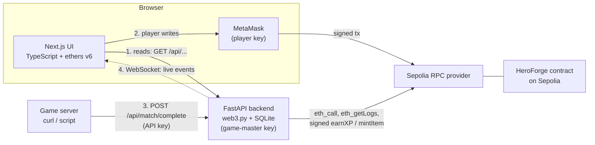

# HeroForge — Technical Design Document

> Own your character. Own your progress.

**Author:** Rahul

**Status:** DRAFT (pre-build). Written before coding, as the brief requires. The final version must describe what was actually built, so every detail in this draft is updated or corrected before submission.

**Related:** [SCOPE.md](SCOPE.md)

---

## 1. Architecture



Players sign their own transactions in MetaMask and send them straight to the RPC provider, so the backend is never in the player's write path. The browser reads data from the FastAPI backend, which reads the contract through the same RPC provider. The backend also holds the game-master key: when a game server calls the match endpoint, the backend signs and sends `earnXP` itself.

The event path back to the browser: the backend polls the RPC for contract events, stores them in SQLite, updates its token-owner index, and pushes each event to connected browsers over a WebSocket.

| Path | Route |
|---|---|
| Player writes | Browser, then MetaMask, then RPC, then contract |
| Operator writes | Game server, then FastAPI, then RPC, then contract |
| Reads | Browser, then FastAPI, then RPC, then contract |
| Live events | Contract, then RPC, then FastAPI poller, then WebSocket, then browser |

## 2. Tech stack

Exact versions are pinned in `requirements.txt` and `package-lock.json` and copied into this table at the end of the build.

| Layer | Technology | Version | Used for |
|---|---|---|---|
| Contracts | Solidity | 0.8.24 (EVM: cancun) | The existing HeroForge contract |
| Contracts | Hardhat | 2.x | Deploy, verify, `setGameMaster` script |
| Contracts | OpenZeppelin Contracts | 5.x | ERC-721 and Ownable |
| Backend | Python | 3.11+ | Backend runtime |
| Backend | FastAPI + Uvicorn | latest stable, pinned | REST API and WebSocket |
| Backend | web3.py | 7.x | Contract reads, event polling, transaction signing |
| Backend | eth-account | via web3.py | Local signing with the game-master key |
| Backend | SQLite (`sqlite3`) | stdlib | Event log, token index, match records |
| Backend | Pydantic | v2, via FastAPI | Request validation |
| Frontend | Next.js (App Router) | pinned in `package.json` | Web app |
| Frontend | TypeScript | 5.x, strict mode | Typed frontend |
| Frontend | ethers.js | 6.x | MetaMask connection and contract writes |
| Tooling | Node.js | 20+ | Frontend and Hardhat |

## 3. Smart contract

- **Network:** Sepolia (chain ID 11155111)
- **Address:** [`0xa574CbE7b3CD4e082D518141E64AF3e795dA487A`](https://sepolia.etherscan.io/address/0xa574CbE7b3CD4e082D518141E64AF3e795dA487A#code) (verified)
- **Deployed source:** `HeroForgeCombined.sol`. The split version (`HeroForge.sol` plus `base/`) was never deployed. Keep only one version in `contracts/` to avoid Hardhat's duplicate-artifact error (HH701).
- **ABI:** copied from the Hardhat artifact into `frontend/src/abi/HeroForge.json` and `backend/app/abi/HeroForge.json`.

**Functions the app uses**

| Function | Called by (role) | Called from |
|---|---|---|
| `mintCharacter(name)` | Player | Frontend |
| `equipItem(charId, itemId)` | Player (must own both) | Frontend |
| `unequipItem(charId, itemId)` | Player (character owner) | Frontend |
| `spendXP(charId, stat)` | Player (character owner) | Frontend |
| `earnXP(charId, amount)` | Game master | Backend |
| `mintItem(to, itemType)` | Game master | Backend |
| `setGameMaster(address)` | Owner | Hardhat script or MetaMask, outside the app |
| `gameMaster()` | Anyone (view) | Backend, start-up check |
| `getCharacter(charId)`, `getItem(itemId)`, `getEquippedItems(charId)` | Anyone (view) | Backend |
| `ownerOf(tokenId)`, `isCharacter(tokenId)`, `hasEquippedItems(charId)` | Anyone (view) | Backend |
| `MAX_STAT()`, `XP_PER_UPGRADE()` | Anyone (view) | Backend, served to the frontend via `/api/config` |

**Events the app listens to**

| Event | What it updates |
|---|---|
| `Transfer` (ERC-721, includes mints) | Backend token-owner index: which address owns which token |
| `CharacterMinted` | Marks the token as a character; new card on Characters page; Activity feed |
| `ItemMinted` | Marks the token as an item; inventory; Activity feed |
| `ItemEquipped` | Equipped list, inventory and transfer-lock notice; Activity feed |
| `ItemUnequipped` | Same as above, in reverse; Activity feed |
| `XPEarned` | XP counter, "+N XP" toast, upgrade button state; Activity feed; marks the matching match record confirmed |
| `StatUpgraded` | Stat rows and XP counter; Activity feed |
| `GameMasterUpdated` | Backend logs a warning and sets `isGameMaster` to false in `/api/health` if the new address is not its own |

## 4. Backend API

Example responses are illustrative and are replaced with real output once the backend is built. Errors use FastAPI's default shape: `{"detail": "..."}`.

| Method | Path | Purpose | Example response |
|---|---|---|---|
| GET | `/api/health` | Status, sync progress, whether the backend is the game master | `{"status":"ok","chainId":11155111,"lastProcessedBlock":9500123,"isGameMaster":true}` |
| GET | `/api/config` | Public config for the frontend | `{"contract":"0xa574…487A","chainId":11155111,"maxStat":100,"xpPerUpgrade":10}` |
| GET | `/api/characters?owner=0x…` | Characters owned by an address, with live stats read from the chain | `[{"id":1,"name":"Thorin","owner":"0x33a1…","xp":20,"strength":1,"speed":1,"defence":1,"equippedItemIds":[1000001]}]` |
| GET | `/api/characters/{id}` | One character | Same object as above |
| GET | `/api/items?owner=0x…` | Items owned by an address | `[{"id":1000001,"itemType":"sword","owner":"0x33a1…","equippedTo":1}]` |
| GET | `/api/events?limit=50` | Most recent contract events, newest first | `[{"type":"XPEarned","block":9500150,"txHash":"0x…","data":{"charId":1,"amount":20,"newTotal":20}}]` |
| POST | `/api/match/complete` | Grants XP. Requires `X-API-Key`. Body: `{"matchId","charId","xp"}` | `{"status":"submitted","matchId":"match-0001","txHash":"0x…"}` |
| POST | `/api/items/grant` | Mints an item. Requires `X-API-Key`. Body: `{"to","itemType"}` | `{"status":"submitted","txHash":"0x…"}` |

**Error codes for the POST endpoints**

| Code | Meaning |
|---|---|
| 401 | Missing or wrong API key. No transaction sent |
| 404 | Character does not exist |
| 409 | `matchId` already used |
| 422 | Invalid input (bad address, `xp` outside 1–100, item type not allowed, bad `matchId` format) |
| 503 | Backend is not the game master, or its wallet balance is too low to send |

**WebSocket: `/ws/events`**

Read-only and public. It carries no secrets. Messages are JSON:

```json
{"type":"hello","lastProcessedBlock":9500123}
{"type":"event","event":"XPEarned","block":9500150,"txHash":"0x…","data":{"charId":1,"amount":20,"newTotal":20}}
```

`hello` is sent on connect. `event` is sent once per new contract event after it has been stored.

## 5. Event handling

- **Which events:** all of those listed in section 3.
- **How:** polling, not subscriptions. A public RPC endpoint often limits or drops WebSocket subscriptions, while `eth_getLogs` over a block range is reliable.
- **Loop:** every `POLL_INTERVAL_SECONDS` (default 5), read `last_processed_block`, then fetch logs from `last_processed_block + 1` up to `latest - 2`, in chunks of at most `LOG_CHUNK_BLOCKS` (default 1000) so public-RPC range limits are not hit. The two-block margin is a small guard against shallow reorgs.
- **Start block:** `START_BLOCK`, set to the contract's deployment block. It is only used on the first run or if the database is deleted.
- **Storing:** each batch is written in a single SQLite transaction together with the new `last_processed_block`, so either everything in the range is stored and the pointer advances, or nothing changes.
- **Idempotent:** events are keyed by `(tx_hash, log_index)`, so processing the same log twice does nothing.
- **Token index:** `Transfer` and the mint events both write to the `tokens` table with upserts, so it does not matter which arrives first inside the same transaction.
- **Broadcast:** after the batch is committed, each new event is pushed to all WebSocket clients.

**If the backend restarts or misses blocks:** it resumes from `last_processed_block + 1`. Because polling is range-based, blocks mined while it was down are fetched on the next loop. A browser that reconnects its WebSocket refetches the current page data over REST, so it also catches up on anything it missed.

**SQLite tables**

```
meta(key PRIMARY KEY, value)                       -- last_processed_block
tokens(token_id PRIMARY KEY, kind, owner)          -- kind: character or item
events(tx_hash, log_index, block, type, data,
       PRIMARY KEY (tx_hash, log_index))
matches(match_id PRIMARY KEY, char_id, xp,
        tx_hash, status, error, created_at)        -- status: pending, submitted, confirmed, failed
grants(id PRIMARY KEY, to_address, item_type,
       tx_hash, status, created_at)                -- audit log of item grants
```

## 6. Frontend

**Pages**

| Route | Purpose |
|---|---|
| `/` | My characters and the mint form |
| `/characters/[id]` | Stats, XP, equipped items, inventory, upgrade / equip / unequip |
| `/activity` | Live event feed |

Shared pieces: a wallet context provider, a network banner, a transaction-status component, a `useTransaction` hook, a `useBackendEvents` hook (WebSocket with automatic reconnect and backoff), typed API wrappers, and a custom-error decoder.

**Wallet handling**

| Situation | Detection | Behaviour |
|---|---|---|
| No MetaMask | `window.ethereum` is undefined | Message with install link. Write buttons disabled. Read-only pages still work |
| Not connected | No accounts returned | **Connect wallet** button. Read-only mode |
| Wrong network | Chain ID is not 11155111 | Red banner and **Switch to Sepolia** button (`wallet_switchEthereumChain`). Write buttons disabled |
| Account changed | `accountsChanged` event | Reload data for the new account and reset transaction state |
| Network changed | `chainChanged` event | Re-check the network and reload the page |
| Connection rejected | Error code 4001 | "Connection request rejected" |
| Request already open | Error code -32002 | "A MetaMask request is already open. Check the MetaMask window." |

**Transaction states**

| State | Meaning | UI |
|---|---|---|
| `idle` | Nothing in progress | Normal buttons |
| `awaiting_signature` | MetaMask prompt is open | Button disabled, "Confirm in MetaMask" |
| `pending` | Hash received, waiting for one confirmation | "Pending" with Etherscan link |
| `confirmed` | Receipt status is 1 | "Confirmed". Refetch the affected character; the WebSocket event updates other views |
| `failed` | Reverted at gas estimation, or receipt status is 0 | "Failed" with the decoded error in plain English |
| `rejected` | User pressed Reject (ethers `ACTION_REJECTED`) | "You rejected the transaction in MetaMask. Nothing was sent." Returns to idle |

A revert is usually caught at gas estimation, before MetaMask asks for a signature, so no gas is spent. If state changes between estimation and inclusion, the transaction can still revert on-chain and arrives as a receipt with status 0. Both cases end in the same `failed` state.

**Custom-error messages.** The frontend decodes revert data with the contract ABI and maps the error name to text:

| Contract error | Message shown |
|---|---|
| `NotCharacterOwner` | You don't own this character. |
| `NotItemOwner` | You don't own this item. |
| `ItemAlreadyEquipped` | This item is already equipped. |
| `ItemNotEquippedToCharacter` | This item isn't equipped to this character. |
| `InsufficientXP` | You don't have enough XP. An upgrade costs 10. |
| `StatCapReached` | This stat is already at the maximum of 100. |
| `InvalidStat` | Unknown stat. |
| `NotACharacter`, `NotAnItem` | That token doesn't exist. |
| `CharacterHasEquippedItems` | Unequip all items before transferring this character. |

**UX checks vs real checks.** Buttons are disabled when XP is below 10, a stat is at 100, or the wallet is on the wrong network. This is only to save the player a failed transaction. The contract enforces every rule regardless of what the UI does.

## 7. Custody and key handling

| Key / secret | Held by | Stored | Can do | If it leaks |
|---|---|---|---|---|
| Player key | The player | MetaMask on their device | Sign `mintCharacter`, `equipItem`, `unequipItem`, `spendXP` for their own tokens | Attacker controls that player's tokens. Outside this system's control |
| Game-master key | The backend | `backend/.env` as `GAME_MASTER_PRIVATE_KEY`. Dedicated testnet-only key | Call `earnXP` and `mintItem` | Attacker can grant XP and mint items until the owner calls `setGameMaster`. Cannot move player NFTs, change the owner or rotate the key. Limited by the per-request XP cap and a small balance |
| Owner (deployer) key | Me | MetaMask. `contracts/.env` for deploy and the rotation script. Never on the backend | `setGameMaster`, `transferOwnership` | Attacker can make themselves game master. This is the root key, so it is kept off the server |
| API key (`MATCH_API_KEY`) | Game operator and backend | `backend/.env`, and the game server's own config | Call the two POST endpoints | Attacker can request grants within the XP cap and allowed item types. Rotate by changing the value and restarting |
| RPC URL / key | Backend and contracts tooling | `backend/.env`, `contracts/.env` | Read the chain, relay transactions | Quota abuse. Rotate with the provider |
| Etherscan API key | Contracts tooling | `contracts/.env` | Verify contracts | Quota abuse. Rotate on Etherscan |
| Frontend | | | Holds no secrets. Only public values prefixed `NEXT_PUBLIC_` | n/a |

**Rules for handling keys**
- Every key lives in a `.env` file that is listed in `.gitignore`. Each of `contracts/`, `backend/` and `frontend/` has a committed `.env.example` with placeholders only.
- Test keys only. No key that has ever held real funds.
- The backend wallet is separate from the deployer wallet. The backend never sees the owner key.
- Before each push, scan the history for secrets (for example `git log --all -p | grep -i private_key`, or a scanner such as gitleaks). The brief deducts 5 marks for any committed key, even if it was later deleted.

## 8. Security and trust assumptions

**Input validation**
- Backend: Pydantic models. `matchId` must match `^[A-Za-z0-9_-]{1,64}$`. `charId` is a positive integer. `xp` is an integer from 1 to `MAX_XP_PER_MATCH`. `to` must be a valid address. `itemType` must be in the allowed list. Owner query parameters are validated as addresses.
- Frontend: character name is 1–32 characters. Names read back from the chain are treated as untrusted text and rendered as plain text only, never as HTML.
- The API key is compared with `secrets.compare_digest`.

**Wrong network.** The frontend checks the chain ID and blocks writes. The backend asserts at start-up that its RPC reports chain ID 11155111 and signs every transaction with that chain ID, so a signed transaction cannot be replayed on another network.

**Rejected and failed transactions.** Handled as described in section 6. Nothing fails silently.

**Unauthorised roles.** Enforced by the contract: `onlyGameMaster`, `onlyOwner` and the character-owner checks. The backend's checks are an extra layer, not a replacement.

**What could an attacker try?**

| Attack | Defence |
|---|---|
| Call `earnXP` or `mintItem` directly on-chain | Contract reverts with `NotGameMaster` |
| Call the match endpoint with no key or a wrong key | 401, no transaction sent |
| Replay the same match request | Duplicate `matchId` returns 409; the unique key in SQLite blocks it even under concurrent requests |
| Send two grants at once to cause a nonce clash | One transaction at a time behind a lock; pending nonce fetched each time |
| Use a leaked API key to inflate XP | Per-request XP cap and allowed item list. Rotate the key. A per-IP rate limit on POST routes is planned |
| Trick the UI into an illegal action | The contract enforces every rule; the UI checks are only convenience |
| Put script or HTML in a character name | Rendered as plain text; React escapes it |
| Pass a bad address or ID to a read endpoint | Validated; returns 422 |
| Call the API from another website in a browser | CORS allows only `CORS_ORIGIN` |
| Steal the game-master key from the server | Limited power (see section 7); owner rotates it with `setGameMaster` |

**What the user has to trust**
1. **The game operator.** Nothing on-chain proves a match really happened. The operator decides when to call the match endpoint, so players trust them to grant XP fairly. In this project "match completed" is simulated by an authenticated API call.
2. **The RPC provider.** The read path shows what the provider reports. Any value can be checked on Etherscan.
3. **The backend's index.** The owner-to-token index is built from events. It is a convenience, and the contract's `ownerOf` is the real answer.
4. **The owner key holder** (me). Whoever holds it can rotate the game master.

## 9. Extension

**Custodial service: the backend holds the game-master key and acts for the game.**

**One-time setup**
1. Generate a new testnet-only wallet for the backend and store its private key in `backend/.env`.
2. Fund it with a small amount of Sepolia ETH from a faucet.
3. From the owner account, call `setGameMaster(<backend address>)` using `contracts/scripts/set-game-master.js`.
4. Start the backend. It checks that `gameMaster()` equals its own address and refuses to run otherwise.
5. Open `/api/health` and confirm `isGameMaster` is true.

**Request flow for `POST /api/match/complete`**
1. The game server sends the request with the `X-API-Key` header.
2. FastAPI checks the key in constant time. Wrong or missing: 401.
3. Pydantic validates the body. Invalid: 422.
4. The backend checks its health flags (is game master, balance above `MIN_GAS_BALANCE_ETH`). Otherwise: 503.
5. It checks the character exists with `isCharacter`. Otherwise: 404.
6. It inserts `matchId` into `matches` with status `pending`. A unique-key violation means a duplicate: 409. A previously `failed` match may be retried.
7. It takes the transaction lock, reads the pending nonce, builds the `earnXP(charId, xp)` transaction with chain ID 11155111 and the provider's EIP-1559 fee data, estimates gas, signs locally with the game-master key, and sends the raw transaction.
8. It stores the transaction hash, sets the status to `submitted`, releases the lock, and returns 200 with the hash.
9. Later, the event poller sees `XPEarned` for that transaction, sets the match to `confirmed`, and broadcasts it over the WebSocket. The open browser updates XP and shows the "+N XP" toast.
10. If sending fails, the match is set to `failed` with the error text, and the endpoint returns a 5xx error so the operator can retry.

`POST /api/items/grant` follows the same steps with `mintItem(to, itemType)`, and records the result in the `grants` table instead of `matches`.

## 10. Configuration

| Variable | Used by | Secret? | Example |
|---|---|---|---|
| `PRIVATE_KEY` | `contracts/` | Yes (owner/deployer) | `your_private_key_here` |
| `SEPOLIA_RPC_URL` | `contracts/`, `backend/` | Yes if it contains a key | `https://ethereum-sepolia-rpc.publicnode.com` |
| `ETHERSCAN_API_KEY` | `contracts/` | Yes | `your_etherscan_api_key_here` |
| `NEW_GAME_MASTER_ADDRESS` | `contracts/` (rotation script) | No | `0x…` backend wallet address |
| `CONTRACT_ADDRESS` | `backend/` | No | `0xa574CbE7b3CD4e082D518141E64AF3e795dA487A` |
| `CHAIN_ID` | `backend/` | No | `11155111` |
| `START_BLOCK` | `backend/` | No | deployment block number |
| `GAME_MASTER_PRIVATE_KEY` | `backend/` | Yes | `your_backend_wallet_key_here` |
| `MATCH_API_KEY` | `backend/`, game server | Yes | `a_long_random_string` |
| `MAX_XP_PER_MATCH` | `backend/` | No | `100` |
| `ITEM_TYPES_ALLOWED` | `backend/` | No | `sword,shield,helmet` |
| `POLL_INTERVAL_SECONDS` | `backend/` | No | `5` |
| `LOG_CHUNK_BLOCKS` | `backend/` | No | `1000` |
| `MIN_GAS_BALANCE_ETH` | `backend/` | No | `0.01` |
| `CORS_ORIGIN` | `backend/` | No | `http://localhost:3000` |
| `DB_PATH` | `backend/` | No | `./data/heroforge.db` |
| `NEXT_PUBLIC_BACKEND_URL` | `frontend/` | No | `http://localhost:8000` |
| `NEXT_PUBLIC_WS_URL` | `frontend/` | No | `ws://localhost:8000/ws/events` |
| `NEXT_PUBLIC_CONTRACT_ADDRESS` | `frontend/` | No | `0xa574CbE7b3CD4e082D518141E64AF3e795dA487A` |
| `NEXT_PUBLIC_CHAIN_ID` | `frontend/` | No | `11155111` |
| `NEXT_PUBLIC_ETHERSCAN_BASE` | `frontend/` | No | `https://sepolia.etherscan.io` |

Anything prefixed `NEXT_PUBLIC_` is sent to the browser, so it must never hold a secret.

## 11. Testing

The 13 Hardhat contract tests from the Solidity course stay in `contracts/test/` and still pass. The table below covers the app. Results are filled in as each case is run.

| Test case | Steps | Expected | Result |
|---|---|---|---|
| 1. Wallet connects on Sepolia | Open app, click Connect | Address shown, green "Sepolia" indicator | Not yet run |
| 2. Mint a character | Enter name, click Mint, confirm | Pending, then Confirmed; new card with STR 1 / SPD 1 / DEF 1, XP 0 | Not yet run |
| 3. Grant an item (custodial) | `POST /api/items/grant` with valid key | Item appears in the player's inventory without refresh | Not yet run |
| 4. Equip an item | Click Equip, confirm | Item moves to Equipped; lock notice appears | Not yet run |
| 5. Unequip an item | Click Unequip, confirm | Item returns to Inventory; lock notice gone | Not yet run |
| 6. Match completes (live event) | Open character page, then `POST /api/match/complete` | XP rises and "+N XP" toast shows, no refresh | Not yet run |
| 7. Upgrade a stat | With 10+ XP, click Upgrade Strength, confirm | Strength +1, XP -10 | Not yet run |
| 8. Wrong network (failure) | Switch MetaMask to Mainnet | Red banner; writes disabled; Switch button works | Not yet run |
| 9. Reject a transaction (failure) | Click Mint, press Reject | "You rejected the transaction"; UI returns to idle | Not yet run |
| 10. Reverted transaction (failure) | Two tabs, 10 XP, upgrade in both | Second shows Failed: "You don't have enough XP" | Not yet run |
| 11. Missing or wrong API key (failure) | `POST /api/match/complete` with no key, then a wrong key | 401 both times; no transaction on Etherscan | Not yet run |
| 12. Duplicate match ID (failure) | Send the same `matchId` twice | Second returns 409; only one `earnXP` on Etherscan | Not yet run |
| 13. Invalid input (failure) | `xp` of 0 and 10000; bad address; unlisted item type | 422 each time | Not yet run |
| 14. Backend not game master (failure) | Start backend with a key that is not the game master | Backend refuses to start with a clear message | Not yet run |
| 15. Restart resumes | Stop backend, grant XP, restart | Missed event appears in Activity feed | Not yet run |
| 16. Read endpoints match the chain | Compare `/api/characters/1` with Etherscan | Values identical | Not yet run |

## 12. Contract changes since the Solidity course

**None (planned).** The contract is unchanged and keeps the same address.

One operational change, not a code change: the game master is moved from the deployer wallet to a dedicated backend wallet with the existing `setGameMaster()`.

If the event-based token index proves unreliable, the fallback is to add a `tokensOfOwner` view, redeploy and re-verify. If that happens, this section is updated with the new address and the reason.

## 13. Known limitations and next steps

**Anticipated limitations (confirmed or corrected after the build)**
- One game-master key is a single point of trust, even though the owner can rotate it.
- Match results are not verified on-chain. The operator is trusted.
- Polling adds a few seconds of delay between a transaction and the screen update.
- The backend uses one SQLite file, so it runs as a single instance.
- Public RPC endpoints can rate-limit or lag.
- Lists are not paginated.
- The app has no transfer or marketplace UI.
- Testnet only.

**Next steps**
- Multi-signature approval for game-master actions, so no single key can grant XP.
- Signed XP vouchers: the game master signs off-chain and the player submits, so the contract verifies the signature.
- IPFS metadata and images for characters and items, with a `tokenURI`.
- Wallet sign-in and an admin page.
- Hosting the frontend and backend.

## 14. Acknowledgements

**Libraries:** OpenZeppelin Contracts, Hardhat, ethers.js, Next.js, React, TypeScript, FastAPI, Uvicorn, Pydantic, web3.py, eth-account, SQLite.

**Course material:** Sessions M2 S1 (nodes, RPC and ethers), S5 (decentralised storage), S6 (keys and signatures) and S8 (multi-signature approval) from the course decks.

**AI tools:** Claude (Anthropic) was used for:
- comparing project ideas against the brief;
- drafting `SCOPE.md` and this document;
- generating the first versions of the HeroForge contract, its tests and the deploy script in the Solidity course;
- *(update as you build)* scaffolding for the backend and frontend.

Every design decision was reviewed by me, and I can explain every line I submit.
